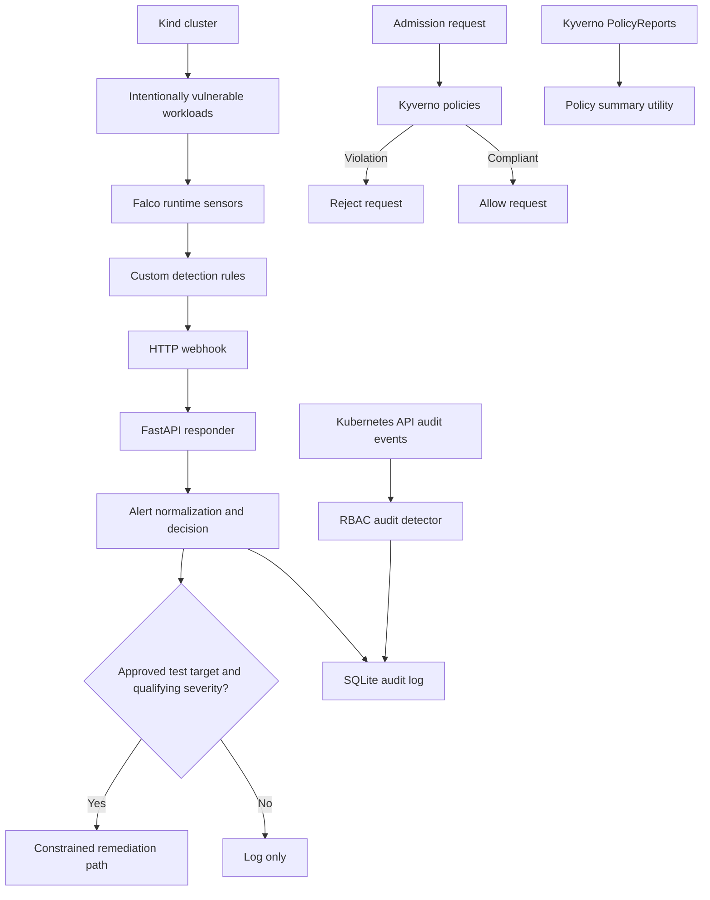

K8s Sentinel
K8s Sentinel is a local Kubernetes security lab for exploring runtime detection, Kubernetes API audit analysis, admission control, and constrained response automation. It uses intentionally vulnerable workloads in a Kind cluster to exercise Falco detections and Kyverno policies.
Lab only: use this project in a disposable local cluster. Do not run attack simulations against production or shared clusters.

Features
- Falco runtime monitoring and custom detection rules.
- Detection scenarios for container process execution, HostPath writes, outbound connections, and shell/network patterns.
- Kubernetes API audit detection for selected ServiceAccount and RBAC operations.
- Five Kyverno admission policies.
- FastAPI webhook responder, alert normalization, and SQLite audit logging.
- Conservative remediation decisions restricted to approved test workloads.
- MITRE ATT&CK mapping, test evidence, and false-positive notes.
Architecture

Repository map
Path	Purpose
cluster/	Kind configuration and Kubernetes audit policy
vulnerable/	Intentionally vulnerable workload manifests
falco/custom_rules.yaml	Custom Falco detection rules
config/falco-http-output.yaml	Falco JSON and webhook output settings
policies/kyverno/	Five Kyverno admission policies
detection/	Falco normalization and RBAC audit detection
responder/app/	FastAPI webhook, decision logic, Kubernetes action safeguards, audit logging
tests/	Python unit and endpoint tests
scripts/	Detection simulation and policy-report utilities
docs/	Rule evidence, false-positive analysis, ATT&CK mappings, policy documentation

Detection coverage
#	Detection scenario	ATT&CK mapping
1	Container command execution	T1609
2	Privileged container process	T1611 — supporting evidence
3	HostPath write	T1611 — supporting evidence
4	Unexpected outbound connection	T1041 — supporting network evidence
5	Crypto-mining heuristic	T1496 — heuristic
6	ServiceAccount sensitive API activity	T1552.007
7	ClusterRoleBinding cluster-admin grant	T1098
8	Reverse-shell-like activity	T1059.004

An alert and its ATT&CK mapping are investigative evidence, not proof that the full technique succeeded. The yes process used by Rule 005 is a simple resource-use heuristic; it does not measure CPU utilization or prove cryptocurrency mining.

See [`docs/mitre_mapping_table.md`](docs/mitre_mapping_table.md), [`docs/rule_test_log.md`](docs/rule_test_log.md), and [`docs/rule_test_results.json`](docs/rule_test_results.json).
Kyverno policies
1. disallow-privileged-containers
2. disallow-hostpath-mounts
3. require-non-root-user
4. restrict-clusterrolebinding-creation
5. require-resource-limits
The project documentation records these policies in Enforce mode with background scanning enabled. PolicyReport counts are background evaluations, not admission-denial counts. See [`docs/kyverno_policies.md`](docs/kyverno_policies.md).
Prerequisites
Install Docker, kubectl, Kind, Helm, Git, and Python 3.12 or a compatible version.
docker --version
kubectl version --client
kind version
helm version
python --version
git --version
Fresh-clone setup
git clone https://github.com/sakoleat-kh/k8s-sentinel.git
cd k8s-sentinel

python -m venv .venv
source .venv/bin/activate
python -m pip install --upgrade pip
pip install -r requirements.txt
Create the local Kind cluster:
kind create cluster --name k8s-sentinel --config cluster/kind-config.yaml
kubectl cluster-info
kubectl get nodes -o wide
Review and deploy Falco
Before deployment, review falco/values.yaml, falco/custom_rules.yaml, and config/falco-http-output.yaml. The webhook URL is environment-specific; update it to an address reachable from the cluster. A host-side 127.0.0.1 address is not automatically reachable from a pod.

The merged deployment values used in the development environment may be local/generated configuration and may not exist in a fresh clone. Regenerate the merged values from the source configuration according to your deployment workflow rather than assuming that file is available.
Deploy Kyverno and policies
Install Kyverno in the cluster using your chosen Helm configuration, then apply the policies:
kubectl apply -f policies/kyverno/
kubectl get clusterpolicies
Wait until the policies report ready before testing.
Deploy the lab workloads
Warning: these manifests intentionally contain risky settings. Apply them only in the disposable lab cluster after reviewing their contents.

kubectl apply -f vulnerable/
kubectl get pods -n default
Start the responder
In another terminal:
cd k8s-sentinel
source .venv/bin/activate
python -m uvicorn responder.app.main:app --host 0.0.0.0 --port 8000
Check health:
curl -fsS http://127.0.0.1:8000/health
Make sure Falco's webhook URL points to an address and port reachable from the cluster.
Run tests
PYTHONPATH=. python -m pytest -q
git diff --check
The latest recorded Python run during the documentation work reported 37 passed. Run the commands again to establish the result for your checkout.
Exercise detections
Inspect scripts before running them:
sed -n '1,240p' scripts/test_all_rules.sh
sed -n '1,240p' scripts/simulate_attacks.sh
The scripts trigger activity in the test cluster and may attempt external connections or Kubernetes API operations. Run them only in the disposable lab.

Example: test command execution in hostpath-pod:
kubectl exec -n default hostpath-pod -- sh -c 'echo K8S_SENTINEL_RULE1_TEST'
Check the current Falco pod names and logs:
kubectl get pods -n falco -o wide
kubectl logs -n falco -l app.kubernetes.io/name=falco   --all-containers=true --since=5m --prefix=true
A successful trigger command alone does not prove the detection fired. Look for the expected rule name, workload target, and technique metadata.
Kyverno policy report summary
With Kyverno installed and reports available:
python scripts/policy_report_summary.py
The script summarizes namespaced PolicyReports and cluster-scoped ClusterPolicyReports, including PASS, FAIL, WARN, ERROR, and SKIP results.
Responder safety
The responder's decision logic is designed to select remediation only for qualifying high-severity alerts targeting approved test workloads. The allowlist restricts eligible targets to namespace default and pod names beginning with k8s-sentinel-remediation-test-; other targets should be log-only.

The project notes do not establish a verified end-to-end remediation success rate. Do not treat unit tests alone as proof that Kubernetes deletion succeeded.
Current status and known limitations
- The saved Day 13 integration artifact dated 2026-09-26 reports 8/8 synthetic detection scenarios passing.
- The latest recorded Python test suite has 37 passing tests.
- Day 28 notes identify Rule 002 as unresolved.
- Rule 005 previously produced repeated alerts; a later trigger did not produce a matching result in the queried recent logs, so current behavior needs re-validation.
- End-to-end automatic remediation has not been verified in the cited bug bash.
- Some historical events had incomplete target or Kubernetes metadata.
- Kyverno background reports may include existing infrastructure resources.
- A repeatable fresh-cluster rebuild remains outstanding.
- The HTTP webhook URL may contain a machine-specific WSL IP address.
See [`docs/bug_bash_notes.md`](docs/bug_bash_notes.md), [`docs/false_positive_log.md`](docs/false_positive_log.md), [`docs/responder_design.md`](docs/responder_design.md), and [`docs/final_report.md`](docs/final_report.md).
Intended use
This is a learning and demonstration lab. Review dependencies and add an explicit repository license if you intend to distribute or reuse the project under a specific license.