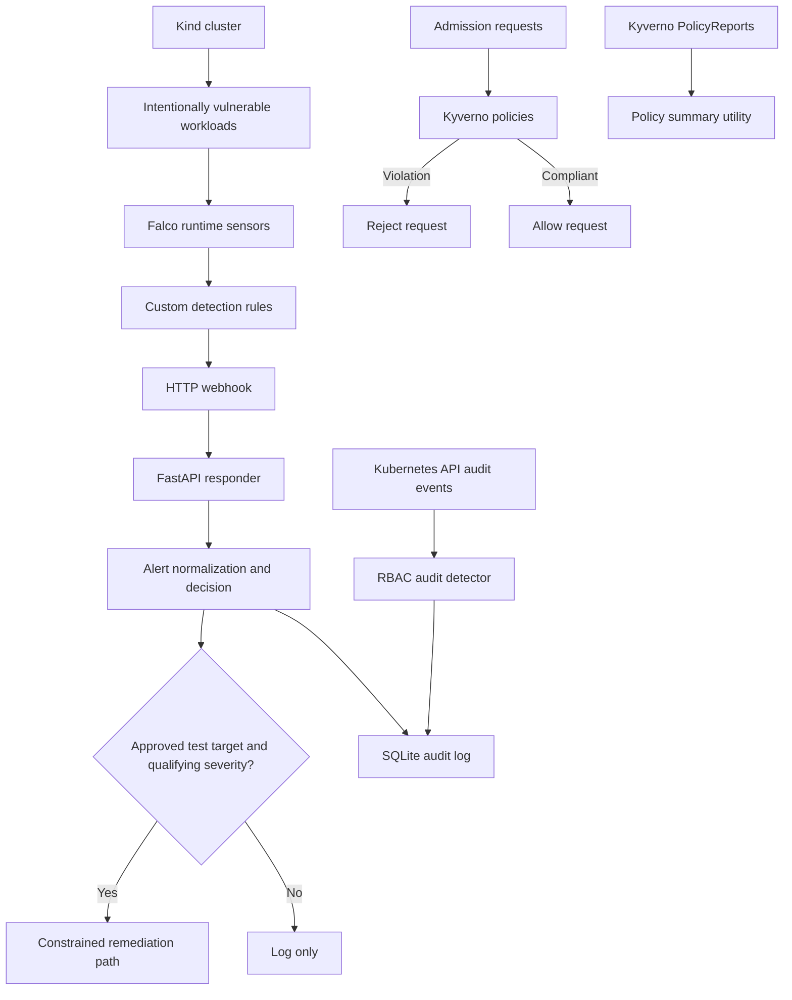

K8s Sentinel — Final Project Report
Environment: Kind Kubernetes cluster, Falco 0.45.1 as recorded in the Day 28 notes, Kyverno, FastAPI responder, SQLite audit log.
Evidence basis: Repository notes and saved test artifacts available on 28 October 2026.
1. Executive summary
K8s Sentinel is a Kubernetes runtime-security lab combining Falco runtime detections, Kubernetes API audit analysis, Kyverno admission controls, alert normalization, SQLite audit logging, and a constrained responder.

The saved Day 13 integration artifact dated 2026-09-26 reports 8/8 synthetic detection scenarios passing. This is historical evidence, not a guarantee that all rules pass in the latest cluster state. The Day 28 bug-bash notes dated 2026-10-27 report a Rule 002 detection gap, repeated alerts from Rule 005, and state that automatic remediation was not verified during that bug bash. The latest Python test run reported during the Day 29 work was 37 passed. Unit tests, runtime detections, and end-to-end remediation are distinct forms of evidence.
2. Problem and motivation
Kubernetes security risks include excessive container privileges, host filesystem mounts, sensitive ServiceAccount permissions, overly broad RBAC bindings, and suspicious runtime activity. Admission controls can reject risky configurations before deployment; runtime detections can identify behavior after a workload starts.

K8s Sentinel provides a local lab to exercise these controls using intentionally vulnerable test workloads. It is a learning and demonstration environment, not a production-ready security platform.
3. Architecture

Component	Role
Kind	Local cluster with control-plane and worker
Vulnerable workloads	Test cases for privileged containers, HostPath, and an over-permissive ServiceAccount
Falco	Runtime event monitoring and custom rules
Kubernetes audit detector	Detect selected sensitive API operations
FastAPI responder	Normalize webhook events, choose actions, record audit entries
SQLite	Persist audit and processed-alert records
Kyverno	Admission enforcement and background evaluation
Reporting scripts	Summarize policy reports and test evidence

4. Detection rules and MITRE ATT&CK mapping
The repository documents eight scenarios. Six custom Falco rules are present in falco/custom_rules.yaml; the ServiceAccount and ClusterRoleBinding scenarios are documented as Kubernetes API audit detections.
#	Detection	ATT&CK mapping	Interpretation
1	Container command execution	T1609 — Container Administration Command; Execution	Detects process execution inside a container
2	Privileged container process	T1611 — Escape to Host; Privilege Escalation	Supporting evidence from a privileged test workload; does not prove a host escape
3	HostPath write	T1611 — Escape to Host; Privilege Escalation	Detects writes through a mounted host path; does not prove host compromise
4	Unexpected outbound connection	T1041 — Exfiltration Over C2 Channel; Exfiltration	Supporting network evidence; does not prove exfiltration or C2
5	Crypto-mining heuristic	T1496 — Resource Hijacking; Impact	yes process heuristic; does not measure CPU percentage or prove mining
6	ServiceAccount sensitive API activity	T1552.007 — Container API credentials; Credential Access	Detects selected sensitive Kubernetes API activity from audit events
7	ClusterRoleBinding cluster-admin grant	T1098 — Account Manipulation; Persistence	Detects a privileged RBAC operation; context determines whether it was unauthorized
8	Reverse-shell-like activity	T1059.004 — Unix Shell; Execution	Shell and external-connection pattern; not proof of a complete intrusion

Technique mappings are contextual labels, not proof that an adversary completed the mapped technique.
Saved detection evaluation
docs/rule_test_results.json records a Day 13 test run on 2026-09-26 with status 8/8 rules verified. It records synthetic evidence for command execution, privileged-container activity, HostPath writes, external connections, a sustained yes process, Secret creation, a cluster-admin ClusterRoleBinding, and shell activity using /dev/tcp.

The later Day 28 notes qualify that historical result: Rule 002 still needed investigation; Rule 005 generated repeated alerts; and automatic remediation was not verified. During the later Day 29 test, timeout 10 yes ended with exit code 124 as expected for a timeout, but a recent-log query returned no matching Rule 005 alert. Current Rule 005 behavior therefore needs re-validation.
5. Kyverno admission policies
The repository contains five ClusterPolicy resources under policies/kyverno/. The project documentation says they use validationFailureAction: Enforce and background: true.
Policy	Protection	Documented validation
disallow-privileged-containers	Rejects privileged containers	Privileged Pod blocked
disallow-hostpath-mounts	Rejects HostPath volumes	HostPath Pod blocked
require-non-root-user	Requires explicit non-root execution	Root-capable Pod blocked
restrict-clusterrolebinding-creation	Restricts cluster-admin bindings to approved subjects	Unauthorized binding blocked; documented approved default/overpermissive-sa binding allowed
require-resource-limits	Requires CPU and memory limits	Pod without both limits blocked

The README records these background-scan results: 35 namespaced PolicyReports, 72 ClusterPolicyReports, 37 PASS, 106 FAIL, 0 WARN, 0 ERROR, and 69 SKIP. These counts describe policy evaluations, not admission webhook denials. Broad policy matching can include existing infrastructure and intentionally vulnerable workloads.

Run the report summary with:
python scripts/policy_report_summary.py
6. Responder and remediation safety
The responder code lives in responder/app/. Its decision logic considers remediation only for qualifying high severities (emergency, alert, critical) and only for an explicitly approved target: namespace default and pod names beginning with k8s-sentinel-remediation-test-. Other targets should select log-only behavior.

The Day 28 notes state that automatic remediation was not verified end to end. Therefore, a measured remediation success rate cannot be claimed from the current evidence. To establish one, run controlled attempts against approved test targets and record eligible alerts, allowlist decisions, action attempts, confirmed deletions/failures, and audit records. State the denominator explicitly.
7. False-positive tuning
docs/false_positive_log.md documents Day 11 baseline alerts from iptables and ip6tables, associated with kube-proxy and kindnet-cni. These were classified as benign Kubernetes networking activity. Rule 001 was tuned to exclude events explicitly identified as belonging to kube-system, while preserving a test in default/hostpath-pod.

A limitation remains: events with missing Kubernetes metadata (<NA>) cannot always be filtered by namespace.

The Day 28 notes also report repeated Rule 005 alerts. The latest log search did not find a matching alert after the most recent trigger, so this issue is not considered resolved.
8. Test and validation evidence
Latest Python test run reported during the Day 29 work:
37 passed
Command:
PYTHONPATH=. python -m pytest -q
git diff --check also completed without errors. These checks validate Python tests and whitespace, but do not replace runtime integration tests, admission tests, or end-to-end remediation verification.

Other repository evidence includes a successful Falco custom-rule schema validation, a Falco rollout reported successful in the Day 28 notes, responder health returning {"status":"ok"}, and a previously successful SQLite integrity check.
9. Limitations
1. The 8/8 detection result is a saved historical test artifact; later notes identify unresolved Rule 002 and Rule 005 issues.
2. Rule 005 is a yes process heuristic, not direct CPU measurement or proof of mining.
3. An external connection alone does not prove exfiltration or C2.
4. ATT&CK mappings do not prove successful completion of the full technique.
5. End-to-end automatic remediation and a remediation success rate are not yet verified in the cited bug bash.
6. Some historical Falco events and audit records had incomplete metadata.
7. Kyverno background reports are not admission-denial counts.
8. Broad policy scope can report existing infrastructure resources.
9. A repeatable fresh-cluster rebuild remains outstanding in the Day 28 notes.
10. The HTTP webhook URL contains an environment-specific WSL IP address and may need changing on another machine.
10. Future work
1. Re-test all eight scenarios against the current cluster and save timestamped evidence.
2. Resolve Rule 002 with a controlled test and inspect actual Falco fields.
3. Tune Rule 005 and verify its event condition against actual emitted fields.
4. Verify fresh Falco-to-responder delivery and target metadata.
5. Exercise the approved remediation path end to end and record confirmed results.
6. Add integration assertions for rule name, target, and technique metadata.
7. Validate a fresh-clone, fresh-cluster setup.
8. Refine Kyverno policy scope where background scans produce unrelated results.
9. Record a demo showing trigger, Falco alert, webhook normalization, audit entry, and safe decision.
10. Keep generated config, machine-specific endpoints, databases, and backups out of commits unless deliberately required.
11. Useful project paths
- Rules: falco/custom_rules.yaml
- HTTP output: config/falco-http-output.yaml
- Test workloads: vulnerable/
- Kyverno policies: policies/kyverno/
- Responder: responder/app/
- Tests: tests/
- Simulations: scripts/test_all_rules.sh, scripts/simulate_attacks.sh
- Rule evidence: docs/rule_test_results.json, docs/rule_test_log.md
- False positives: docs/false_positive_log.md
- ATT&CK mapping: docs/mitre_mapping_table.md
- Kyverno documentation: docs/kyverno_policies.md
- Policy summary: scripts/policy_report_summary.py
Run simulation scripts only in the disposable lab cluster. A successful trigger command is not by itself proof that the corresponding detection fired.
12. Conclusion
K8s Sentinel demonstrates a security-engineering workflow spanning runtime detection, Kubernetes audit analysis, admission controls, alert normalization, audit logging, and conservative remediation decisions. Evidence includes a historical 8/8 synthetic detection run, five documented Kyverno policies, and a latest Python test suite with 37 passing tests.

The remaining work is to re-validate current detections, resolve the documented Rule 002 and Rule 005 issues, verify remediation end to end, and prove fresh-cluster reproducibility. This report distinguishes these gaps from the results already recorded.